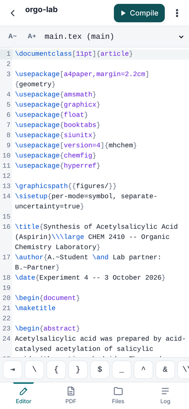
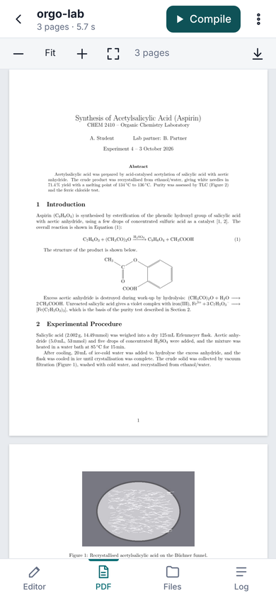
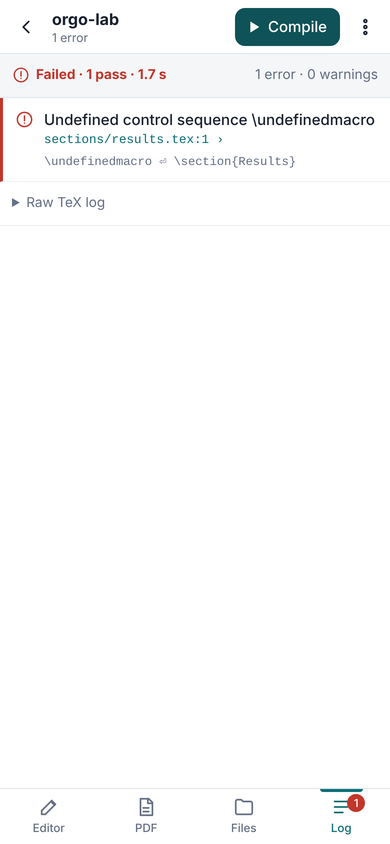
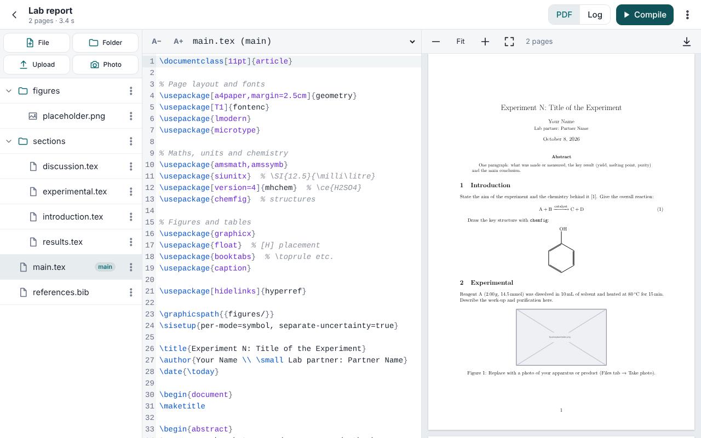

# PocketTeX

**Overleaf in your pocket.** PocketTeX is an offline-first LaTeX editor that runs entirely in the browser. It is built for phones (iOS Safari, Android Chrome) and works on desktop too.

- **Real pdfTeX:** pdfTeX 1.40.21 with BibTeX, compiled to WebAssembly, runs in a Web Worker on your device. There are no servers, accounts or tracking.
- **Overleaf projects:** import an Overleaf `.zip` (`main.tex`, `\input` sections, `figures/`, `.bib`), edit it, compile it, and export the `.zip` again.
- **Lab-report packages built in:** chemfig, mhchem, siunitx, graphicx, booktabs, float, geometry, amsmath, hyperref and about 80 more are precached, so they work in airplane mode.
- **Everything else on demand:** about 18,000 TeX Live files are fetched when first needed and then cached. *Make available offline* prefetches whatever a project uses.
- **Static hosting:** the whole app is static files on GitHub Pages and installs to the Home Screen as a PWA.

| Editor (phone) | PDF | Tappable errors |
|---|---|---|
|  |  |  |



## Using it

1. Open the site, e.g. `https://<user>.github.io/PocketTeX/`.
2. Install it:
   - **iOS:** Share → *Add to Home Screen*.
   - **Android:** ⋮ → *Install app*.

   Wait for **"● Ready offline"** at the bottom of the project list. At that point the app, the engine (about 17 MB in total) and the bundled packages are cached.
3. **New lab report** starts from a template with sections, a chemfig structure, a siunitx table, a figure and a bibliography.
4. **Import .zip** takes an Overleaf export (Overleaf: *Menu → Download → Source*). PocketTeX finds the main file: the `.tex` that contains `\documentclass`, preferring `main.tex`. Change it with *Files → ⋮ → Set as main file*.
5. On a phone, the bottom tabs switch between **Editor / PDF / Files / Log**. On screens 900 px or wider, files, editor and PDF sit side by side, with PDF and Log sharing the right-hand column.

**Editor**
- CodeMirror 6 with LaTeX highlighting.
- Completion for commands, `\ref`/`\cref` labels, `\cite` keys from your `.bib`, and `\includegraphics`/`\input` paths.
- Every change is saved automatically to the device.
- The accessory bar above the keyboard has `⇥ \ { } $ _ ^ & \\`, plus snippets for `\ce{}`, `\SI{}{}`, a figure and a booktabs/siunitx table. ⇥ jumps to the next snippet field. It also has cursor arrows and undo/redo.
- A−/A+ change the text size.

**Compile**
- Runs as many pdfLaTeX passes as needed: it reruns while the `.aux`/`.toc`/`.out` files change, up to 5 passes. It runs BibTeX automatically when the citations or `.bib` files change.
- Recompiles reuse the previous `.aux`, so a typical edit costs one pass (about 2 s on a laptop, a few seconds on a phone).
- *Compile* turns into *Stop* while running, in case a macro loops forever.
- Ctrl/⌘+Enter compiles, and Ctrl/⌘+S saves.

**PDF**
- pdf.js preview with fit-width, zoom buttons and two-finger pinch zoom.
- Your reading position (page and offset) is kept across recompiles, including when you compile from the Editor tab.

**Log**
- Errors and warnings are parsed from the TeX log, with the file and line inside `\input` files. Tap one to jump to that line in the editor.
- Over/underfull boxes are collapsed. The raw TeX and BibTeX logs are available underneath.

**Files**
- New file or folder, upload, rename/move, delete, and set the main file.
- **Photo** opens the camera (`<input capture>`), downscales the picture to at most 2000 px as a JPEG (a few hundred KB instead of several MB), and saves it in `figures/`. *Insert figure* then adds a `figure` environment at the cursor.

**Get your work out**
- *Download PDF*.
- *Share PDF…* (Web Share API, e.g. AirDrop or WhatsApp, where available).
- *Export project (.zip)*, which Overleaf can import again.

**Storage**
- Projects live in IndexedDB on this device. PocketTeX calls `navigator.storage.persist()` when you create or import a project; *⋮ → About & storage* shows whether persistence was granted and how much space is used.
- **Export a .zip now and then: there is no cloud copy.**

## Supported features and known limits

**Supported**

- pdfLaTeX documents: `article`, `report`, `book`, `beamer` and other classes in TeX Live's latex-base, -recommended and -extra collections.
- Precached (works offline from the first visit): amsmath/amssymb/amsthm/mathtools, babel (English), booktabs, caption/subcaption, chemfig (+TikZ/PGF), cleveref, enumitem, fancyhdr, float, fontenc/inputenc, geometry, gensymb, graphicx, hyperref, lmodern, longtable, makecell, mhchem, microtype, multirow, natbib, setspace, siunitx, tabularx, textcomp, titlesec, upgreek, url, wrapfig and xcolor, plus their dependencies and fonts: Computer Modern, Latin Modern, and cm-super for T1 at the usual sizes.
- On demand (cached once fetched): everything in Ubuntu 24.04's `texlive-latex-base`, `-latex-recommended`, `-latex-extra`, `-science`, `-pictures`, `-fonts-recommended`, `-plain-generic`, `-bibtex-extra` and `-lang-english`, plus `lmodern` and `cm-super`. That includes pgfplots, tcolorbox, chemmacros, physics, etc.
- **BibTeX** (`\bibliography{…}` with any `.bst`, natbib) runs automatically.
- Images: PNG, JPG and PDF via graphicx.
- `\input`/`\include` across sub-folders, and multiple projects.

**Known limits**

- **pdfTeX only.** There is no XeTeX or LuaTeX, so `fontspec`, `unicode-math`, system and OpenType fonts, and `polyglossia` won't work. Use `inputenc`/`fontenc` and Type 1 font packages.
- **No biber.** `biblatex` needs `backend=bibtex` instead of the default biber. `makeindex`, `glossaries` and `xindy` are not run.
- **No shell escape.** `minted`, `svg`, `gnuplottex`, `epstopdf` and anything else that runs external programs won't work.
- **EPS images are not supported**: pdfTeX can't include them and Ghostscript isn't available. Convert them to PDF or PNG first.
- **Memory and size.**
  - The engine's WebAssembly heap is about 160 MB, mostly fixed-size TeX arrays. The format and bundle add about 35 MB. iOS kills tabs that use too much.
  - Long theses (100+ pages), many huge images or heavy TikZ/pgfplots may be slow or crash the engine. PocketTeX then restarts it on the next compile.
  - Keep photos downscaled (the Photo button does this) and split huge documents.
- **Compiles stop at the first error** (halt-on-error), so a broken document gives no PDF; the previous PDF stays visible.
- Bitmap (PK) fonts cannot be generated, so fonts without a Type 1 version fail.
- **Versions.** The engine is pdfTeX 1.40.21 (2020) and the packages are TeX Live 2023. A package that needs a newer pdfTeX primitive will fail.
- Text files must be UTF-8 to be editable. Other encodings are kept as binary and still compile and export unchanged.
- A main file in a sub-folder compiles from the project root, as on Overleaf, so its `\input`/`\includegraphics` paths are relative to the root.
- **Storage can be cleared by the browser.** On iOS, *website* data can be evicted after about 7 days without use; data of apps added to the Home Screen is kept. Install the app, and export `.zip` backups.

## How it works

### Choosing the engine

| | SwiftLaTeX PdfTeXEngine | BusyTeX |
|---|---|---|
| Maintenance | Last commit Jun 2024, last binary release Feb 2022: unmaintained. | Active repository; last published WASM release Nov 2023. |
| Engine | pdfTeX 1.40.21 + **BibTeX** in one 1.8 MB wasm | pdfTeX/XeTeX/LuaTeX + bibtex8 in a 29 MB wasm |
| Packages | Fetched one file at a time from `texlive2.swiftlatex.com`. **That host no longer resolves (checked Oct 2026), so the package source is dead.** | Emscripten data bundles on GitHub Releases (texlive-basic 100 MB, latex-extra 47 MB, …), each loaded whole into memory |
| Fit for phones | Good: small, lazy file access | Poor: about 190 MB to download and hold in RAM |

PocketTeX uses SwiftLaTeX's **unmodified** pdfTeX wasm (see [`public/engine/SOURCE.txt`](public/engine/SOURCE.txt)) and **replaces its dead package server** with a static TeX Live tree built from Ubuntu's TeX Live 2023 packages:

```
scripts/build-texlive.mjs
  ├─ runs the wasm engine in Node to dump the LaTeX format (pdflatex.ini) → swiftlatexpdftex-<hash>.fmt.gz (6 MB)
  ├─ compiles the seed documents (tests/fixtures/orgo-lab, templates/lab-report, scripts/texlive/seeds/*)
  │  and records every file pdfTeX opens → bundle-<hash>.bin.gz (348 files, 5.7 MB, precached)
  └─ copies the rest of the TeX Live tree → tree/<texmf path> + tree/manifest.json (18k files, 335 MB, on demand)
```

When pdfTeX asks kpathsea for a file, the worker ([`public/engine/engine-worker.js`](public/engine/engine-worker.js)) looks in this order:

1. the precached bundle;
2. files already loaded from Cache Storage;
3. the manifest, then a synchronous fetch from the tree, which the service worker answers from its cache when offline.

The compile loop (passes, BibTeX) is in [`public/engine/driver.js`](public/engine/driver.js) and is shared with the Node build tooling. The [service worker](src/sw-template.js) precaches the app shell, the engine, the format and the bundle, keyed by content hash so unchanged files survive updates. On-demand package files go in a separate, persistent cache.

### Configuration

| Setting | Where | Default |
|---|---|---|
| `VITE_TEXLIVE_ENDPOINT` | build-time env | `texlive/tree/` (this site's own copy) |
| `BASE_PATH` | build-time env | `/` (the workflow sets `/<repo>/`) |

`VITE_TEXLIVE_ENDPOINT` is the **single switch** for where on-demand packages come from. To self-host:
1. Upload `texlive-build/tree/` to any static host that sends `Access-Control-Allow-Origin: *`.
2. Build with `VITE_TEXLIVE_ENDPOINT=https://your.host/tree/ npm run build`.

The format and bundle always ship with the app. The tree must come from the same `build:texlive` run as the format, because they share one LaTeX kernel.

## Building

Requirements:
- Node 22.
- TeX Live, used only at build time to supply package files. On Ubuntu 24.04:

```sh
sudo apt-get install --no-install-recommends texlive-latex-base texlive-latex-recommended \
  texlive-latex-extra texlive-science texlive-pictures texlive-fonts-recommended \
  texlive-plain-generic texlive-bibtex-extra texlive-lang-english lmodern cm-super
```

```sh
npm ci
npm run build:texlive          # format + bundle + tree → texlive-build/ (≈40 s; add `-- --tree seeds` for a tiny tree)
npm run dev                    # http://localhost:5173 (no service worker in dev)
BASE_PATH=/PocketTeX/ npm run build   # → dist/
```

To precache another package, use it in a document under `scripts/texlive/seeds/` and rerun `npm run build:texlive`.

### Tests

```sh
npm run test:unit      # TeX log parser (node:test)
npm run test:engine    # compiles tests/fixtures/orgo-lab with the wasm engine in Node, expects 3 pages
npm run test:e2e       # Playwright + Chromium against dist/ (build with BASE_PATH=/PocketTeX/ first)
```

The end-to-end suite runs at 390×844, and also at 1280×800 for the wide layout:
1. Zips `tests/fixtures/orgo-lab` and imports it through the UI.
2. Compiles it and checks the downloaded PDF with pdf.js: valid, more than 50 KB, exactly 3 pages. The same page count comes from TeX Live's native `pdflatex`.
3. Checks that the PDF scroll position survives recompiles.
4. Goes **offline by shutting the web server down**. Playwright's `setOffline()` does not stop service-worker network traffic, so a real shutdown is used, and the test checks that an uncached URL really fails. It then reloads and compiles again.
5. Checks that an error in `sections/results.tex` is listed with its line and jumps to the editor.
6. Covers on-demand packages (lipsum, tcolorbox) through *Make available offline* and then offline, and compiling the template.

Screenshots land in `tests/artifacts/screens/`.

The fixture (`tests/fixtures/orgo-lab/`) is an aspirin-synthesis lab report with:
- four `\input` sections;
- a PNG (TLC plate) and a JPG (product photo);
- a chemfig structure;
- `\ce{}` equations;
- a siunitx `S`-column table;
- `\ref`/`\eqref` cross-references;
- a BibTeX bibliography.

## Deploying to GitHub Pages

[`.github/workflows/pages.yml`](.github/workflows/pages.yml) installs TeX Live, builds the format/bundle/tree and the app with `BASE_PATH=/<repo>/`, then runs the unit, engine and end-to-end tests. On the default branch it deploys `dist/` to Pages.

**One-time setup:** *Settings → Pages → Build and deployment → Source: GitHub Actions*.

The deployed site is about 360 MB, almost all of it the on-demand tree, which is within Pages' 1 GB limit. If you use a custom domain at the root, change the workflow's base path to `/`.

## License

PocketTeX is free software under the **GNU Affero General Public License v3.0** ([LICENSE](LICENSE)). This matches the bundled SwiftLaTeX engine (AGPL-3.0, [source](https://github.com/SwiftLaTeX/SwiftLaTeX)). Because the app is served over a network, the AGPL requires the source to be available. This repository is public, and the in-app *About* dialog links to it and to the engine source.

Third-party components:
- TeX Live packages and fonts: their own free licences, mostly LPPL, GPL and OFL, as distributed by TeX Live/Debian.
- pdf.js: Apache-2.0.
- CodeMirror: MIT.
- JSZip: MIT or GPL-3.0.
